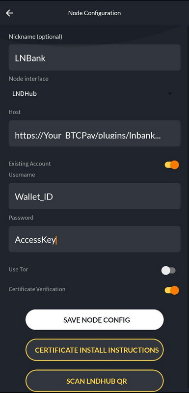

import Tabs from '@theme/Tabs';
import TabItem from '@theme/TabItem';

# Connecting BTCPay Server with ZEUS

BTCPay Server is a payment processor system and could connect to ZEUS in two modes: as node management (LND) or as LNDhub with the plugin LNBank activated on BTCPay.

### Using LND interface

1. In your BTCPay instance, go to **Server Settings -> Services** and select the LND REST service. It will show you a QR code to scan.
2. Open ZEUS and go to **Settings -> Wallets -> +**, press the scan icon in the top-right corner, and scan the QR code.
3. ZEUS asks you to confirm before it fetches the config from your BTCPay Server, then pre-fills a new wallet config with **LND (REST)** as the wallet interface.
4. Disable **Certificate Verification**.
5. Enable **Use Tor** if your BTCPay is running behind Tor.
6. Click on **Save Wallet Config**.
7. You can now use your BTCPay account as a LN wallet with ZEUS.

ZEUS no longer supports the c-lightning-REST interface, so BTCPay's Core Lightning QR code cannot be used.

### Using LNBank plugin

Keep in mind that lndhub interfaces will not provide any on-chain bitcoin address, only Lightning use.
Unfortunately there is [an issue with ZEUS, which prevents import via QR scan](https://github.com/ZeusLN/zeus/issues/1081). Until this is fixed you have to import the wallet by entrering the details manually.

In ZEUS you can use this path to import the wallet:
1. Open ZEUS and go to **Settings -> Wallets**.
2. Click the plus icon in the top right corner to add a new wallet.

You will land on the following screen and have to …



- Choose **LNDHub** as the **Wallet interface**
- Enable the **Existing Account** toggle

On that screen you then have to fill in the host, username and password fields. The values for these fields are included in the account URL which you can copy on the LNbank wallet settings page.

Copy the account URL and paste it into a note app on your mobile device. It consists of the following parts:

```lndhub:// USERNAME : PASSWORD @ HOST```

You can ignore the ```lndhub:// part```, the username and password are separated by an ```:``` and the host is what comes after the ```@```. Copy those values into the corresponding fields in ZEUS and then click **Save Wallet Config**.

The parts map like this:

- Username = LNbank Wallet ID
- Password = LNbank Wallet Access Key (Admin)
- Host = ```YOUR_BTCPAY/plugins/lnbank/api/lndhub```